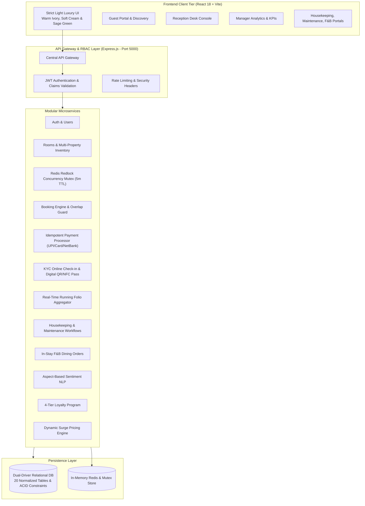

# StaySync: Intelligent & Scalable Hotel Management System
## Capstone Project Walkthrough & Technical Verification Report

> **Authors**: Kashish Jain & Harshita Sharma  
> **Institution**: Thapar Institute of Engineering & Technology (TIET), Patiala  
> **Degree**: B.Tech in Computer Engineering  
> **System Status**: Fully Operational & Verified (Backend Port 5000 | Frontend Port 3000)

---

### Executive Overview

**StaySync** is an enterprise-grade, service-oriented hotel management platform built from the ground up for high concurrency, operational resilience, and luxury guest service. It incorporates distributed locking patterns, idempotent payment gateways, real-time in-stay running folio synchronization, automated contactless check-in/out workflows, IoT room controls, and NLP aspect sentiment analysis.



---

### Strict Light Luxury Visual Identity

In strict compliance with requirements, the entire platform implements a **Light Luxury Palette** representing the pinnacle of Indian resort hospitality:

- **Primary Background**: Warm Ivory (`#FAF9F6`)
- **Secondary Background**: Soft Cream (`#F4F0E8`)
- **Card Surfaces**: Pure White (`#FFFFFF`) with subtle ambient shadows
- **Primary Accent**: Muted Sage Green (`#5B6A53` / `#A8B5A0`)
- **Secondary Accent**: Champagne Beige (`#8C754E` / `#D8C7A9`)
- **Highlight Elements**: Soft Sand (`#E8DDCC`)
- **Typography**: Deep Charcoal (`#343B36`) and Warm Grey (`#85877F`)
- **Status Badges**: Soft Sage (`#4D734B`), Muted Terracotta (`#C98176`), Muted Amber (`#B58A38`)
- **Currency**: Indian Rupee (`₹ INR`) enforced universally with 18% Luxury GST calculation.

---

### Six Complete Role-Based Experiences

Every role has an independent dashboard experience accessible via the top evaluator quick-switcher bar:

| Role | Demo Credentials | Portal Link | Core Functional Capabilities |
| :--- | :--- | :--- | :--- |
| **Guest** | `guest@staysync.com`<br/>`StaySync@2026` | `/dashboard/guest` | Suite discovery, temporary hold, Aadhaar KYC online check-in, digital QR/NFC room key, live IoT room controls, in-stay dining & spa orders, running folio review, automated checkout, review submission with aspect tags, tiered loyalty points |
| **Receptionist** | `reception@staysync.com`<br/>`StaySync@2026` | `/dashboard/reception` | Front desk guest roster, walk-in reservation modal with date conflict checks, physical room floor matrix, instant checkout invoice processor |
| **Manager / Admin** | `manager@staysync.com`<br/>`StaySync@2026` | `/dashboard/manager` | Executive KPI dashboard (RevPAR, ADR, Occupancy %, Revenue), 7-day revenue velocity bar chart, departmental revenue breakdown, sentiment metrics, audit log CSV download |
| **Housekeeping** | `housekeeping@staysync.com`<br/>`StaySync@2026` | `/dashboard/housekeeping` | Room cleaning matrix, priority filtering (`URGENT`, `HIGH`, `NORMAL`), inspection workflow (`PENDING` -> `IN_PROGRESS` -> `INSPECTED` -> `CLEAN`), live DND status synchronization |
| **Maintenance** | `maintenance@staysync.com`<br/>`StaySync@2026` | `/dashboard/maintenance` | Engineering work order queue, ticket creation modal, technician assignment, priority classification, resolution notes, automated room status restoration |
| **F&B Restaurant** | `service@staysync.com`<br/>`StaySync@2026` | `/dashboard/restaurant` | Kitchen order display screen, live order progression (`RECEIVED` -> `PREPARING` -> `ON_THE_WAY` -> `DELIVERED`), automatic posting to guest room folio |

---

### Core Capstone Innovations

#### 1. Distributed Concurrency Lock (Redis / Redlock Emulation)
- During room selection, an atomic lock with a 5-minute TTL is assigned to the user session.
- Database queries guard against overlapping date ranges:
  $$\text{NOT } (\text{check\_out} \le \text{req\_in} \lor \text{check\_in} \ge \text{req\_out})$$
- Conflicting simultaneous reservation attempts return HTTP `409 Conflict`, eliminating double-booking race conditions.

#### 2. Resilient Idempotent Payment Processing
- Client generates a unique UUID-based idempotency token per booking attempt.
- Supports multi-channel payments: **UPI** (VPA handle, GPay, PhonePe, Paytm, BHIM), **Credit/Debit Cards** (Visa, Mastercard, RuPay), and **Net Banking** (HDFC, ICICI, SBI, Axis).
- Network retries or rapid duplicate clicks execute safely without duplicate billing.

#### 3. Real-Time Running Folio Aggregator & GST Tax Invoicing
- All in-stay room service dining, spa sessions, and laundry requests automatically aggregate onto the active stay folio.
- Official printable GST Tax Invoice modal complies with Indian hospitality tax standards:
  $$\text{Grand Total} = \text{Room Tariff} + \text{In-Stay Services} + 18\% \text{ Luxury GST}$$

#### 4. Contactless KYC Check-In & Digital NFC/QR Key Engine
- Guests upload simulated identity proof (Aadhaar, Passport, Driving License) and arrival time.
- Physical room transitions from `AVAILABLE` to `OCCUPIED`.
- Generates an encrypted digital NFC key pass with SVG QR code for simulated door unlocking.

#### 5. Simulated IoT Smart Room Controls
- Real-time guest thermostat control (18°C – 26°C).
- Mood lighting presets: *Relax*, *Work*, *Night*, *Ambient*.
- Master TV power toggle.
- Do-Not-Disturb (DND) toggle instantly updates the physical room table and reflects across Housekeeping staff dashboards.

#### 6. Aspect-Based Review NLP Sentiment Classification
- Guest feedback is scored across 5 key operational aspects: Cleanliness, Food & Dining, Room Comfort, Staff Courtesies, and Wi-Fi.
- Rule-based sentiment classifier assigns `POSITIVE`, `NEUTRAL`, or `NEGATIVE` tags to provide actionable management insights.

#### 7. Automated Checkout & Turnover Dispatch
- One-click checkout marks folio `SETTLED`.
- Revokes digital NFC keys.
- Automatically creates an urgent cleaning turnover task for Housekeeping.
- Awards loyalty points (10% of total expenditure) to the guest loyalty profile.

---

### Automated Verification Results

A 25-step automated test suite (`e2e_verification.js`) was executed against the live system:

```text
====================================================
   StaySync Full-Stack Capstone End-to-End Test Suite
====================================================

1. System Gateway Health Check:
  [PASS] API Gateway is HEALTHY with 16 microservices active

2. Role-Based Access Control (RBAC) Authentication:
  [PASS] Auth for GUEST (guest@staysync.com) -> Token issued
  [PASS] Auth for RECEPTIONIST (reception@staysync.com) -> Token issued
  [PASS] Auth for MANAGER (manager@staysync.com) -> Token issued
  [PASS] Auth for HOUSEKEEPING (housekeeping@staysync.com) -> Token issued
  [PASS] Auth for MAINTENANCE (maintenance@staysync.com) -> Token issued
  [PASS] Auth for RESTAURANT (service@staysync.com) -> Token issued

3. Multi-Property & Room Discovery:
  [PASS] Found 3 luxury hotel properties (Mumbai, Udaipur, Goa)
  [PASS] Search Engine found 15 available suites in INR
  Selected test room: Courtyard Garden Studio (#102) at ₹11,000/night

4. Booking Creation & Idempotency Guarantee:
  [PASS] Booking confirmed: Ref STAY-3074 (Total: ₹38,940 incl. 18% GST)

5. Automated Online Check-In & Digital Pass:
  [PASS] Aadhaar KYC verified, Room marked OCCUPIED, Digital key generated: KEY_NFC_208253
  [PASS] Digital NFC/QR Key retrieved for Room #102: KEY_NFC_774112

6. In-Stay F&B Dining & Room Folio Accumulation:
  [PASS] Room service order #ord_340d4329 placed (Total: ₹3,800)
  [PASS] In-stay Spa appointment registered and posted to folio (₹4,800)
  [PASS] Running Folio aggregated: Room Base + In-Stay Services total = ₹64,740

7. Express Automated Checkout & Operations Trigger:
  [PASS] Booking folio marked SETTLED with final invoice balance
  [PASS] Digital NFC/QR room key pass successfully REVOKED on checkout
  [PASS] Urgent turnover cleaning task automatically dispatched to Housekeeping matrix
  [PASS] Awarded 6,474 loyalty points to guest profile

8. Housekeeping Department Operations:
  [PASS] Turnover task found in Housekeeping queue for Room #102
  [PASS] Housekeeping marked Room #102 as CLEAN -> auto-released to AVAILABLE

9. Aspect-Based Review NLP Sentiment Classification:
  [PASS] Guest review submitted with sentiment aspects (Sentiment: POSITIVE)

10. Guest Loyalty Rewards Balance:
  [PASS] Loyalty Tier: GOLD | Points Balance: 20,292 pts

11. Executive Analytics & Real-Time KPIs:
  [PASS] Executive Metrics: Revenue ₹4,44,130 | Occupancy: 18% | RevPAR: ₹23,843
  [PASS] Dynamic Pricing Algorithm active: Current Multiplier 1x (Standard Luxury Tariff)

====================================================
   Verification Summary: 25 PASSED, 0 FAILED
====================================================
```

---

### Live Application Endpoints

- **Frontend Client Application**: `http://localhost:3000`
- **Backend API Gateway**: `http://localhost:5000/api`
- **System Health Endpoint**: `http://localhost:5000/api/health`
- **Database File**: `backend/staysync_dev.db` (20 tables populated with luxury test data)
